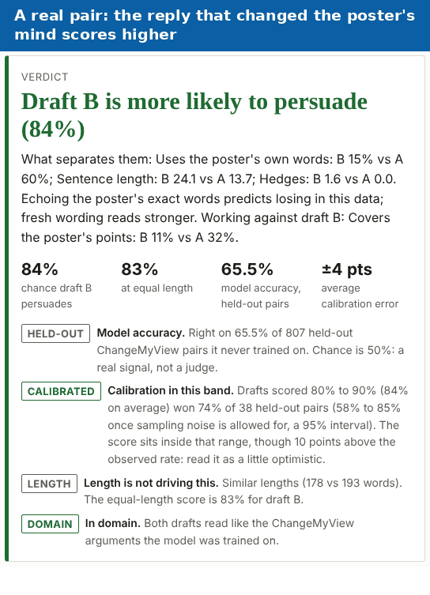
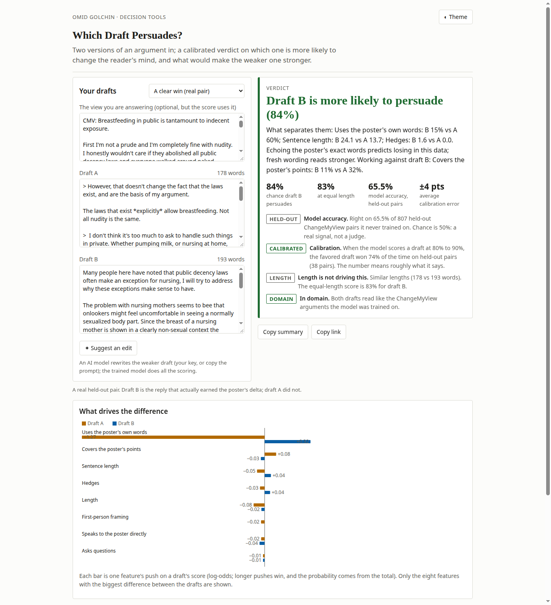

# Which Draft Persuades?

For anyone choosing between two versions of an argument: paste the view you are answering and both drafts, and get a calibrated verdict on which draft is more likely to change the reader's mind, what drives the difference, and how far to trust the number, from a model trained on 4,263 real ChangeMyView argument pairs.





**Use it:** https://omidgolchin.github.io/persuasion-checker/ (runs in your browser; nothing you type is sent anywhere unless you use the AI edit with your own key)

## What it does

- **Compare two drafts.** The original view (optional, but the score uses it) and two draft replies. The verdict gives the leading draft's calibrated probability ("Draft B is more likely to persuade (78%)"), the two or three features that separate them in plain words, and the model's held-out accuracy next to the number.
- **What the model rewards.** The verdict also names the weaker draft's biggest lever in plain words ("Draft A would score higher with links to evidence"), from the same feature gaps the edit brief below uses — no key and no edit needed to see it. It hides when no feature separates the drafts by enough to name one.
- **An equal-length score.** Length alone leans verdicts (longer replies won 59.7% of held-out pairs), so the tool also scores both drafts cut to the same length, and says when length is doing real work.
- **A domain warning.** Drafts far from the ChangeMyView arguments the model learned from (very short, marketing copy, legal boilerplate) get flagged instead of a confident number.
- **Suggest an edit.** The tool composes a brief (both drafts, its scores, which draft is weaker and what it is missing); a language model, with your own key or by copy-pasting the prompt into any assistant, rewrites the weaker draft. The tool then re-scores the edit with the trained model. The language model never produces a score.
- **Copy summary / Copy link.** A plain-text summary for a message or doc, and a link that reopens the tool with the same drafts.
- **Start here.** The page opens with the question it answers and three steps; a list of common situations fills the drafts; and a section says when to use the tool and when not.
- **Help where you need it.** Every draft box has a line under it saying what to paste there, and every technical term in the inputs and results has a **?** that opens a plain-language explanation.

## Built-in checks

| Check | What it tells you |
|---|---|
| Model accuracy | The model was right on 65.6% of 807 held-out pairs it never trained on. Chance is 50%: a real signal, stated so nobody over-trusts the verdict. |
| Calibration in this band | The held-out reliability band your score falls in, with a 95% interval on its observed win rate: drafts scored 80–90% (84% on average) won 74% of 38 pairs, 58% to 85% once sampling noise is allowed for. A score inside the interval is reported as calibrated, with the gap named when it is 5 points or more; outside it, the check says the model is overconfident there. Average error across bands is about 4 points. |
| Length | Whether the drafts' size difference is leaning the verdict, with the equal-length score quoted. |
| Domain | Whether both drafts read like the arguments the model was trained on; flagged drafts get the warning in the verdict as well. |
| Edit scored | After an AI-suggested edit is applied, before/after probabilities under the same model. |

## Design decisions

The full log is in DECISIONS.md. The load-bearing ones:

- **A paired model, because persuasion is relative.** Following Tan et al. (2016), the model never scores a draft alone: it compares two replies to the same view, which controls the topic. Training pairs are replies to one post where exactly one changed the poster's mind.
- **The plan was frozen before training.** Split, twelve interpretable features, model class and metrics are in PLAN.md, committed before any fitting. Nothing was tuned after seeing the held-out numbers.
- **Calibration is a separate step on separate data.** A Platt scaling fitted on 684 development pairs (never used to fit the weights, never the test pairs) makes the probabilities mean what they say; the reliability table is computed on the 807 held-out pairs.
- **Length is shown, not hidden.** Rather than debiasing length away, the tool reports the equal-length score beside the main one and lets the reader judge.
- **The corpus is not redistributed.** The Winning Arguments data is distributed by its authors for research use; `make data` re-downloads it, and the raw files are git-ignored (DATA_SOURCES.md). The page ships only the fitted weights and six short example pairs.

## Validation

- **17 tests** (`make test`): the browser's feature extraction equals the Python extractor's on the shipped examples and edge strings; the browser's probabilities equal the Python scoring mirror's on ten fixed pairs; the frozen split recomputes exactly (2,772 / 684 / 807) from the pair data; the reported accuracy and calibration error recompute from the stored per-pair predictions; the equal-length comparison flips the length example and is exact on a constructed pair; every verdict state is reached; the assist's prompt, reply parsing and quote checks; and a page-level check (`scripts/page_check.js`) renders the page in a headless browser and asserts the verdict's "what the model rewards" line names the weaker draft, follows the pair when the drafts swap sides, hides for a pair too short to score, and stays put while the visitor types (it skips where no headless browser is available locally, and fails in CI instead).
- **AI extraction: not yet run.** The assist's 20-brief test set (`assist/testset.json`, scored by `scripts/eval_assist.js`) ships ready; running it needs a visitor-side model key, and no model calls were made for this build. Field accuracy should be read on `weaker` and `features_to_add`; `edited_draft` is a rewrite and carries no expected value by design (see DECISIONS.md).
- Checked in a browser engine on desktop (1366px) and phone (390px) widths, in light and dark themes, with no console errors; every example loads into its verified verdict state, and the assist round trip (open, paste a reply, apply, re-score, undo) was exercised end to end.

## What I learned

- **Echoing the poster loses.** The model's second-largest weight is negative: replies that reuse the poster's exact words did worse, once a separate feature credits covering the poster's points. Arguing in your own words beat quoting the view back at its author.
- **Length is the strongest single signal, and it is still weak.** The full model reaches 65.6% on held-out pairs. Twelve surface features separate winners from losers far less than I expected; most of persuasion is in the content, which this model cannot read.
- **Acknowledgement is not argument.** "Good point"-style openers slightly predict losing once the other features are counted. They usually arrive with agreement rather than a counter-argument.
- **Calibration survives.** After Platt scaling, predicted bands track actual win rates closely (ECE 0.035), including the honest middle: scores near 50% really are coin flips.

## Common situations

The form opens with "Start from a common situation". Each entry fills the form and says what it shows:

| Situation | What it shows |
|---|---|
| A clear win (real pair) | A held-out pair where the model backs the draft that earned the delta. |
| Links and numbers (real pair) | Links to evidence and numbers push for draft B, along with length. |
| Winning on length (real pair) | Cut to equal length, the model flips: length did much of the work. |
| Too close to call (real pair) | The model finds almost nothing between them. |
| Two short replies (written for this demo) | Outside the training data: the tool warns. |
| Marketing copy (written for this demo) | Not an argument: the verdict is a rough guess at best. |

To add a situation, append an entry `{label, note, op, a, b}` to `docs/examples-data.js`; real pairs must come from the held-out set.

## When to use it, and when not

Use it to choose between two versions of a reply in a discussion or debate (answering someone's stated view, a review comment, a forum post or an op-ed rebuttal) and to see which surface features separate them.

| It assumes | If yours differs |
|---|---|
| The reader is like a ChangeMyView poster: someone who stated a view and invited replies. | Readers who did not ask to be persuaded, or who decide for other reasons (a buyer, a grant panel), may respond differently. The domain check flags text far from the training data, but not every difference in audience. |
| Both drafts answer the same view, and the score is relative. | It cannot say whether either draft is good, only which of the two leads. Two weak drafts still produce a winner. |
| The model reads twelve surface features: length, links, numbers, questions, wording overlap with the view and similar. | It cannot read whether an argument is true, logical or kind. Most of persuasion is in the content, which this model does not see; treat the verdict as a tie-breaker. |
| English replies of a few sentences to a few paragraphs. | Very short text, other languages and long documents fall outside the training data. |
| Accuracy on held-out pairs (65.6%) carries over to your drafts. | Your drafts may differ from Reddit replies in ways the domain check cannot see, so the real accuracy can be lower. |

Do not use it to judge marketing copy or ads (test them on real readers; the A/B Test Decision Tool reads the result), to fact-check a claim, to score a single draft on its own, or for decisions where being wrong a third of the time is too costly.

## Where it comes from, and how it was generalised

The tool is a trained model, and the study is the model. It follows Tan, Niculae, Danescu-Niculescu-Mizil and Lee (2016), *Winning Arguments*, who collected replies on Reddit's ChangeMyView, where a poster awards a "delta" to the reply that changed their mind. From that corpus, 4,263 pairs were built: two replies to the same post, one of which earned the delta.

The plan was frozen before training (split, twelve interpretable features, a logistic model, the metrics). The model was then fitted on 2,772 pairs, its probabilities calibrated on 684 others, and tested once on 807 held-out pairs: right on 65.6%, with predicted bands tracking actual win rates (average error about 4 points). Length was the strongest single signal; replies that echoed the poster's exact words did worse.

**How it was generalised.** The model scores any two drafts that answer the same view, not only Reddit replies. To keep that honest, the tool adds what the study did not need: a domain warning for text unlike the training data, an equal-length score so length alone cannot decide the verdict, and an optional AI edit whose result is re-scored by the same model. A comparison with a language-model judge is planned and not yet run.

## Research notes

The trained model is the study artifact: `results/summary.md` has the full weights, the reliability table and the per-pair predictions behind every number on the page, and PLAN.md is the frozen protocol. One comparison is planned as a follow-up post and small study, not yet run: the same held-out pairs scored by a TF-IDF logistic baseline and by an LLM judge, against this interpretable model, to see what the extra complexity buys. No results are claimed for it here.

## Run it

```bash
make venv                  # venv + pinned dependencies
make data                  # download the corpus and build the pairs (not redistributed; see DATA_SOURCES.md)
make analyze               # retrain the model, rebuild the examples and the assist testset
make test                  # all checks, including JS/Python agreement
make serve                 # the tool at http://localhost:8000
```

Score the assist's extraction against any model with `scripts/eval_assist.js` (needs that provider's API key in the environment); it is an offline quality check, separate from the tool.

## Layout

- `docs/`: the tool (plain HTML and JavaScript, no build step). `persuasion.js` is the scoring engine, `model-data.js` the fitted weights (generated from `docs/data/model.json`), `examples-data.js` the examples, `assist-config.js` the AI assist's prompt, and `tool-common.js` / `tool.css` / `kit.css` the shared tool kit.
- `src/persuasion/`: pair construction, the twelve features (the single source both Python and the page mirror), training, and the Python scoring mirror used by the tests.
- `assist/` and `scripts/eval_assist.js`: the assist's 20-brief test set and its scorer.
- `PLAN.md`, `FREEZE_MANIFEST.txt`, `DECISIONS.md`, `SPEND.md`: the frozen plan, its hashes, every judgment call, and the cost record ($0).

## Limitations

- One community (r/ChangeMyView), one format (a written reply to a stated view), 2013–2015. Persuasion elsewhere, and now, may reward different things.
- The features are surface signals: length, overlap, markers. The model cannot tell whether a claim is true, and a draft written to please it would score well without persuading anyone. The domain warning catches only some of that.
- 65.6% held-out accuracy is the honest ceiling of these features. Treat the verdict as a second reader with known blind spots, not a judge.

## References

- Tan, C., Niculae, V., Danescu-Niculescu-Mizil, C., & Lee, L. (2016). *Winning Arguments: Interaction Dynamics and Persuasion Strategies in Good-faith Online Discussions.* Proceedings of WWW 2016. (The paired design and the corpus.)
- Chang, J. P., Chiam, C., Fu, L., Wang, A., Zhang, J., & Danescu-Niculescu-Mizil, C. (2020). *ConvoKit: A Toolkit for the Analysis of Conversations.* Proceedings of SIGDIAL 2020. (The corpus distribution used here.)
- Platt, J. (1999). *Probabilistic Outputs for Support Vector Machines and Comparisons to Regularized Likelihood Methods.* (The calibration scaling, applied to the logistic scores.)

## License

MIT for the code in this repository (see LICENSE). The Winning Arguments corpus is not covered by that license and is not redistributed here; see DATA_SOURCES.md for its terms.
